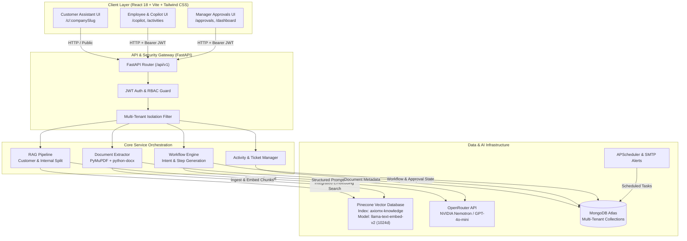
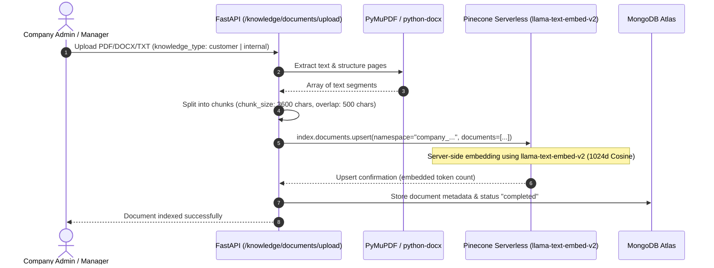

# AXIOMX – AI Business & Customer Operations Copilot

> **An enterprise multi-tenant operations platform unifying customer-facing RAG support and internal business workflow automation through end-to-end Conversation-to-Resolution architecture.**

[](https://fastapi.tiangolo.com)
[](https://react.dev)
[](https://tailwindcss.com)
[](https://www.mongodb.com/atlas)
[](https://www.pinecone.io)
[](https://openrouter.ai)
[](https://python.org)
[](https://nodejs.org)

---

## 1. Project Overview

**AxiomX** is a production-engineered, multi-tenant operations platform built for **INDUSTRIX 2026 (Problem Statement PS#601)**. Modern enterprises often face high operational friction when customer inquiries, complaints, and warranty requests are isolated from internal execution systems. Customer support teams collect issues in silos, while internal operations, maintenance, procurement, and facility teams work in disconnected spreadsheets and ticketing tools.

AxiomX solves this challenge by bridging external customer conversations with internal business execution via **Conversation-to-Resolution Automation**.

---

## 2. Problem Statement

* **Hackathon:** INDUSTRIX 2026
* **Problem Statement:** PS#601
* **Title:** Improve Business Operations and Customer Response Speed Through Digitization and AI.

### Challenges Addressed
1. **Slow Customer Response Times:** Manual triage of repetitive warranty questions, policy inquiries, and product manual lookups.
2. **Disconnected Operations:** Customer complaints rarely translate into tracked internal maintenance or parts procurement tasks without manual re-entry.
3. **Internal Approval Bottlenecks:** Requests for equipment, parts, and maintenance stall in email chains without strict role-based approval governance.
4. **Data Isolation & Knowledge Bleed:** Risk of leaking confidential internal operating procedures to customer-facing channels, or blending data across enterprise tenants.

---

## 3. Proposed Solution

AxiomX provides a dual-engine architecture:

### A. AI Customer Assistant
* Company-specific RAG chatbot embedded into customer touchpoints (`/c/:companySlug`).
* Grounded exclusively in verified customer-facing policy, product, and warranty documents using **Pinecone Serverless Documents API** with integrated `llama-text-embed-v2` dense embeddings.
* Real-time customer complaint registration, immediate ticket reference generation, and self-service status tracking.
* Human support escalation when questions fall outside verified knowledge boundaries.

### B. AI Business Copilot
* Natural language business request understanding (category classification, priority assessment, and missing information detection).
* Structured workflow step generation and human-in-the-loop review.
* Multi-tier manager approval routing with strict self-approval prevention.
* Activity assignment, department routing, and execution status tracking.

### Key Differentiator: Conversation-to-Resolution Automation
Customer conversations and support tickets can directly initialize internal business workflow requests. When a customer reports a defective hydraulic seal, the support agent or employee can link the ticket reference ID (`tkt_...`) into the AI Business Copilot. The Copilot extracts the required action, generates an equipment maintenance activity, requests manager budget approval, and routes the task to the engineering team—bringing the customer issue to full physical resolution.

---

## 4. Key Features

| Category | Feature | Status |
|---|---|---|
| **Customer Assistant** | Company-isolated public RAG chatbot (`/public/companies/{slug}/chat`) | Implemented |
| **Customer Assistant** | Strict customer/internal knowledge isolation | Implemented |
| **Customer Assistant** | Customer complaint & support ticket creation (`/public/companies/{slug}/tickets`) | Implemented |
| **Customer Assistant** | Public ticket status self-service tracking (`/public/companies/{slug}/tickets/{id}`) | Implemented |
| **Customer Assistant** | Citation badges and knowledge source attribution | Implemented |
| **Business Copilot** | Natural language request understanding & intent parsing | Implemented |
| **Business Copilot** | Missing information & ambiguity detection | Implemented |
| **Business Copilot** | Multi-step workflow generation & employee review | Implemented |
| **Business Copilot** | Multi-tier manager approval console with remarks | Implemented |
| **Business Copilot** | Anti-self-approval enforcement (`409 Conflict`) | Implemented |
| **Operations Engine** | Activity creation, status transitions & department assignment | Implemented |
| **Knowledge Base** | Multi-format document parser (`.pdf`, `.docx`, `.txt`) via PyMuPDF | Implemented |
| **Knowledge Base** | Pinecone Documents API integrated embedding ingestion | Implemented |
| **Security & Auth** | Multi-tenant company registration & JWT authentication | Implemented |
| **Security & Auth** | Role-Based Access Control (`company_admin`, `manager`, `employee`, `support_agent`) | Implemented |
| **Background Tasks** | APScheduler automated reminders & notification tracking | Configurable |
| **Notifications** | SMTP transactional alerts | Configurable |

---

## 5. System Architecture



---

## 6. Technology Stack

| Layer | Component | Technology | Version / Specification |
|---|---|---|---|
| **Frontend** | Framework | React.js | 18.3.1 |
| **Frontend** | Bundler & Dev Server | Vite | 6.0.1 |
| **Frontend** | Styling & UI | Tailwind CSS | 3.4.16 |
| **Frontend** | Routing | React Router DOM | 6.28.0 |
| **Frontend** | Iconography | Lucide React | 0.468.0 |
| **Backend** | Framework | FastAPI | >= 0.115 |
| **Backend** | ASGI Web Server | Uvicorn | >= 0.30 |
| **Backend** | Validation & Schemas | Pydantic & Pydantic-Settings | >= 2.8 |
| **Backend** | Authentication | PyJWT + bcrypt | PyJWT >= 2.9, bcrypt >= 4.2 |
| **Database** | Primary Document Store | MongoDB Atlas (PyMongo) | pymongo >= 4.11 |
| **Vector DB** | Vector Index | Pinecone Serverless | pinecone >= 10.1.0 |
| **Embedding** | Integrated Embedding Model | `llama-text-embed-v2` | 1024 Dimension, Cosine Metric |
| **LLM Provider** | Inference Gateway | OpenRouter API | NVIDIA Nemotron 3 / OpenAI GPT-4o-mini |
| **Document Processing** | Extraction & Chunking | PyMuPDF (fitz) + python-docx | PyMuPDF >= 1.24, python-docx >= 1.1 |
| **Scheduling** | Background Tasks | APScheduler | >= 3.10 |
| **Testing** | Test Suite & Smoke Testing | Pytest & Custom Integration Runner | pytest >= 8.3 |

---

## 7. Repository Structure

```text
PS601/
├── .editorconfig                # Universal indentation and formatting rules
├── .gitignore                   # Monorepo-level ignore (secrets, build, venv, caches)
├── README.md                    # Project-level architecture and operations manual
│
├── frontend/                    # React 18 + Vite + Tailwind CSS Application
│   ├── public/                  # Static assets and browser icons
│   ├── src/
│   │   ├── components/
│   │   │   ├── common/          # StatusBadge, LoadingSpinner, EmptyState
│   │   │   └── layout/          # Navbar, Sidebar
│   │   ├── context/             # AuthContext (JWT session, tenant state)
│   │   ├── pages/               # Landing, CustomerAssistant, Dashboard, Copilot, Knowledge, Tickets, Approvals, Activities
│   │   ├── services/            # Centralized API service with token refresh
│   │   ├── App.tsx              # Application route tree and route protection
│   │   ├── index.css            # Tailwind directives and custom scrollbars
│   │   ├── main.tsx             # React root mount
│   │   └── vite-env.d.ts        # Vite environment variable typings
│   ├── .dockerignore
│   ├── .env.example             # Frontend public environment template
│   ├── index.html               # Main HTML entrypoint
│   ├── package.json             # Frontend dependency manifest
│   ├── postcss.config.js        # PostCSS configuration for Tailwind
│   ├── tailwind.config.js       # Tailwind CSS theme extension
│   ├── tsconfig.json            # TypeScript configuration
│   └── vite.config.ts           # Vite build and proxy configuration
│
└── BACKEND/                     # FastAPI Application (backend service)
    ├── app/
    │   ├── api.py               # API route definitions and HTTP handlers
    │   ├── main.py              # Application factory, lifespan, CORS & health endpoints
    │   ├── core/
    │   │   ├── config.py        # Pydantic Settings reading .env
    │   │   └── security.py      # JWT creation, decoding, bcrypt password hashing
    │   ├── database/
    │   │   └── mongodb.py       # PyMongo Atlas connection and index management
    │   ├── dependencies/
    │   │   └── authentication.py# Current user extraction & role-based dependencies
    │   ├── integrations/
    │   │   ├── openrouter.py    # OpenRouter chat completion client
    │   │   └── pinecone_client.py# Pinecone Documents API client (EmbedQuery & Upsert)
    │   ├── schemas/
    │   │   └── common.py        # Pydantic validation models
    │   └── services/
    │       └── documents.py     # Document extraction (PDF/DOCX/TXT) & chunking
    ├── scripts/
    │   └── axiomx_smoke_test.py # Pre-development live integration test script
    ├── tests/
    │   └── test_app.py          # Pytest unit and integration test suite
    ├── uploads/                 # Local directory for uploaded files (.gitkeep)
    ├── .dockerignore
    ├── .env.example             # Complete backend environment template
    ├── .gitignore               # Backend-specific ignore
    ├── pytest.ini               # Pytest testpath & warning configuration
    ├── requirements.txt         # Python package dependencies
    └── README.md                # Backend quickstart guide
```

---

## 8. Prerequisites

To run AxiomX locally, ensure the following runtimes and services are available:

* **Python:** Version `3.11` to `3.14` (installed with pip)
* **Node.js:** Version `18.x` or higher (verified on `v24.14.1`)
* **npm:** Version `9.x` or higher (verified on `11.11.0`)
* **MongoDB Atlas Account:** Cluster URI with read/write database permissions.
* **Pinecone Account:** An active Pinecone Serverless account with the pre-configured index:
  * Index Name: `axiomx-knowledge`
  * Integrated Model: `llama-text-embed-v2`
  * Dimension: `1024`
  * Metric: `Cosine`
* **OpenRouter Account:** API key with access to chat models (e.g. `nvidia/nemotron-3-ultra-550b-a55b:free` or `openai/gpt-4o-mini`).

---

## 9. Environment Configuration

### Backend Configuration (`BACKEND/.env`)
Create `BACKEND/.env` by copying `BACKEND/.env.example`:

```powershell
cp BACKEND/.env.example BACKEND/.env
```

Populate the required configuration values:

```env
APP_NAME=AxiomX
APP_ENV=development
API_V1_PREFIX=/api/v1
CORS_ORIGINS=http://localhost:5173,http://localhost:3000

# MongoDB Atlas
MONGODB_URI=mongodb+srv://<username>:<password>@<cluster>.mongodb.net
MONGODB_DATABASE=axiomx

# Pinecone Serverless
PINECONE_API_KEY=pcsk_your_key_here
PINECONE_INDEX_NAME=axiomx-knowledge
PINECONE_EMBEDDING_FIELD=chunk_text
PINECONE_TITLE_FIELD=title
PINECONE_NAMESPACE_PREFIX=company_
PINECONE_BATCH_SIZE=96

# OpenRouter
OPENROUTER_API_KEY=sk-or-v1-your_key_here
OPENROUTER_BASE_URL=https://openrouter.ai/api/v1
OPENROUTER_MODEL=openai/gpt-4o-mini
OPENROUTER_TIMEOUT=30

# Security
JWT_SECRET_KEY=replace_with_a_secure_random_string_min_32_chars
JWT_ALGORITHM=HS256
ACCESS_TOKEN_EXPIRE_MINUTES=60
REFRESH_TOKEN_EXPIRE_DAYS=14

# Optional: SMTP Email Alerts
SMTP_ENABLED=false
```

> **Security Rule:** Never commit the real `.env` file to Git. The `.gitignore` file strictly excludes `.env` and `.env.*`.

### Frontend Configuration (`frontend/.env`)
Create `frontend/.env` by copying `frontend/.env.example`:

```powershell
cp frontend/.env.example frontend/.env
```

```env
VITE_API_BASE_URL=http://localhost:8000/api/v1
VITE_APP_TITLE=AxiomX Operations Copilot
```

---

## 10. Backend Installation & Startup

Open a Windows PowerShell terminal:

```powershell
# 1. Navigate to the backend directory
cd BACKEND

# 2. Create and activate a Python virtual environment
python -m venv .venv
.\.venv\Scripts\Activate.ps1

# 3. Install required Python packages
pip install -r requirements.txt

# 4. Start the FastAPI development server
uvicorn app.main:app --reload --host 127.0.0.1 --port 8000
```

### API Documentation Endpoints
* **Swagger UI (Interactive API Explorer):** [http://localhost:8000/docs](http://localhost:8000/docs)
* **ReDoc (Document Specification):** [http://localhost:8000/redoc](http://localhost:8000/redoc)
* **Service Health Check:** [http://localhost:8000/health](http://localhost:8000/health)
* **Service Readiness Check:** [http://localhost:8000/ready](http://localhost:8000/ready)

---

## 11. Frontend Installation & Startup

Open a second PowerShell terminal:

```powershell
# 1. Navigate to the frontend directory
cd frontend

# 2. Install Node.js dependencies
npm install

# 3. Start the Vite development server
npm run dev
```

The frontend application will be live at:
* **Web UI:** [http://localhost:5173](http://localhost:5173)

---

## 12. How the Application Works

### Flow 1: AI Customer Assistant & Knowledge Retrieval
1. Customer visits `/c/:companySlug` (e.g., `/c/apex-industrial`).
2. The UI retrieves company identity from `/public/companies/{company_slug}`.
3. The customer asks a question: *"What is the warranty period for replacement hydraulic cylinders?"*
4. The backend queries Pinecone inside the company namespace (`company_{company_id}`) filtering strictly by `knowledge_type == "customer"`.
5. Pinecone embeds the query using `llama-text-embed-v2` and returns the top relevant text chunks.
6. The backend prompts OpenRouter to synthesize an accurate answer strictly constrained to the retrieved context.
7. If the answer cannot be found, the assistant advises the user to register a support ticket.

### Flow 2: Customer Complaint Registration & Tracking
1. The customer switches to the **Submit Ticket** tab on the public portal.
2. The customer provides contact details, subject, and description.
3. The backend stores the ticket in MongoDB under `support_tickets` and returns a reference ID (`tkt_...`).
4. The customer tracks resolution progress on the **Track Ticket** tab using their ticket ID and registered email.

### Flow 3: AI Business Copilot & Workflow Automation
1. An employee signs into the workspace and opens the **AI Business Copilot** (`/copilot`).
2. The employee types a business need: *"Urgent: Purchase 5 high-pressure seals for Line 2 immediately to stop hydraulic leak."*
3. The employee optionally enters a linked customer ticket reference (`tkt_...`) to activate **Conversation-to-Resolution**.
4. The Copilot analyzes intent (`understand-request`), classifying it as a `purchase_request` with `high` priority.
5. The employee clicks **Generate Workflow**, generating a structured action plan.
6. The employee reviews and confirms the workflow (`confirm-workflow`).
7. Because purchase requests involve expenditure, the system automatically routes the item to the **Approvals Console** (`/approvals`).

### Flow 4: Manager Approval & Activity Execution
1. The manager logs in and opens `/approvals`.
2. The manager reviews the request details and remarks. Self-approval is strictly blocked by the backend API.
3. The manager approves the request, transitioning its status to `approved`.
4. The maintenance team receives the activity on the **Activities & Tasks** board (`/activities`), executes the repair, marks it `completed`, and adds resolution notes.
5. The linked support ticket is marked `resolved`, completing the cycle from customer issue to physical resolution.

---

## 13. RAG Architecture & Vector Indexing

AxiomX avoids external vector generation libraries by utilizing **Pinecone Documents API with Integrated Embeddings**.



### Knowledge Isolation Matrix
* **Customer Namespace Partition:** Filtered by `knowledge_type: "customer"`. Queried exclusively by `/public/companies/{slug}/chat`. Never returns confidential internal policies.
* **Internal Namespace Partition:** Filtered by `knowledge_type: "internal"`. Accessible only by authenticated employees and managers through the Business Copilot.

---

## 14. Testing & Verification

AxiomX contains automated unit tests and a live end-to-end integration smoke test.

### Running Automated Unit Tests
From the `BACKEND/` directory:

```powershell
python -m pytest
```

Test coverage includes:
* OpenAPI route registry validation.
* Password hashing and bcrypt verification.
* JWT token creation, expiration, and claims verification.
* JWT refresh token rotation logic.
* Document chunking and boundary overlap algorithms.
* Pydantic schema validation across company registration, chat, tickets, and copilot requests.

### Running Pre-Development Integration Smoke Test
To verify live external cloud services (MongoDB Atlas, Pinecone, OpenRouter, and SMTP):

```powershell
python BACKEND/scripts/axiomx_smoke_test.py
```

Expected output:
```text
=================================================================
                    FINAL SMOKE TEST SUMMARY
=================================================================
| Service         | Test                             | Result   |
|-----------------|----------------------------------|----------|
| MongoDB Atlas   | Connection and read/write        | Pass     |
| Pinecone        | Index connection and readiness   | Pass     |
| Pinecone        | Integrated embedding insertion   | Pass     |
| Pinecone        | Semantic retrieval               | Pass     |
| OpenRouter      | LLM response generation          | Pass     |
| SMTP            | Connection and authentication    | Skipped  |
=================================================================
ALL REQUIRED PRE-DEVELOPMENT INTEGRATION TESTS PASSED.
```

### Frontend Build Verification
To test TypeScript compilation and asset bundling:

```powershell
cd frontend
npm run build
```

Output:
```text
✓ 1598 modules transformed.
dist/index.html                   0.91 kB
dist/assets/index-DyYSdZjV.css   28.97 kB
dist/assets/index-jrVGfZiL.js   263.34 kB
✓ built in 4.26s
```

---

## 15. Deployment & Production Readiness

### Backend Production Checklist
1. **Disable Debug Mode:** Set `DEBUG=false` and `APP_ENV=production` in the production environment.
2. **CORS Allowlist:** Set `CORS_ORIGINS` to the exact production domain (e.g. `https://axiomx.yourdomain.com`). Never use `*` in production.
3. **Secret Rotation:** Generate a cryptographically secure 256-bit JWT secret (`openssl rand -hex 32`).
4. **Persistent Upload Storage:** In containerized environments, mount a persistent volume (or S3/GCS bucket) to the directory specified by `UPLOAD_DIR`.
5. **MongoDB Network Access:** Ensure your production server IP addresses are whitelisted in MongoDB Atlas Network Access.
6. **APScheduler Multi-Worker Deployment:** If running multiple Uvicorn workers (`--workers 4`) or replica containers, run the scheduler in a dedicated standalone worker to prevent duplicate scheduled jobs.

### Frontend Production Checklist
1. **API Endpoint:** Set `VITE_API_BASE_URL` to your production backend API domain (e.g. `https://api.axiomx.yourdomain.com/api/v1`).
2. **Static Asset Hosting:** Serve the generated `frontend/dist/` directory using Nginx, Cloudflare Pages, Vercel, or AWS S3 + CloudFront.
3. **HTTPS Enforcement:** Always serve both frontend and backend over TLS/HTTPS.

---

## 16. Security Considerations

* **No Leaked Secrets:** Neither Pinecone nor OpenRouter API keys are ever shipped to or accessible by the frontend client. All LLM and vector operations are gated behind authenticated FastAPI server endpoints.
* **Multi-Tenant Isolation:** Every database query enforces tenant separation (`company_id`). Pinecone vectors are partitioned into distinct company namespaces (`company_{company_id}`).
* **Anti-Self-Approval:** The approval engine strictly checks that `requested_by != current_user.user_id` when approving or rejecting requests.
* **File Upload Protections:** PyMuPDF extraction enforces file size caps (`10MB`), verifies file extensions (`.pdf`, `.docx`, `.txt`), sanitizes file names, and rejects unextractable/scanned PDFs requiring OCR.
* **No Dynamic Code Execution:** All AI copilot outputs are parsed into strict Pydantic data schemas; no arbitrary LLM-generated code is ever evaluated or executed.

---

## 17. Limitations & Future Roadmap

* **OCR for Scanned Documents:** Currently, uploaded scanned PDFs containing pure raster images without embedded text layers require pre-processing via an external OCR pipeline (e.g. Tesseract or Google Cloud Vision).
* **Multi-Instance Scheduler Lock:** The background scheduler currently runs single-instance. A distributed Redis lock is planned for multi-region clustering.
* **WebSocket Streaming:** Real-time token streaming for the customer chat interface is slated for the upcoming v1.1 release.

---

## 18. Hackathon & Event Information

* **Hackathon:** INDUSTRIX 2026
* **Problem Statement:** PS#601 – Improve Business Operations and Customer Response Speed Through Digitization and AI
* **Project Name:** AxiomX – AI Business & Customer Operations Copilot
